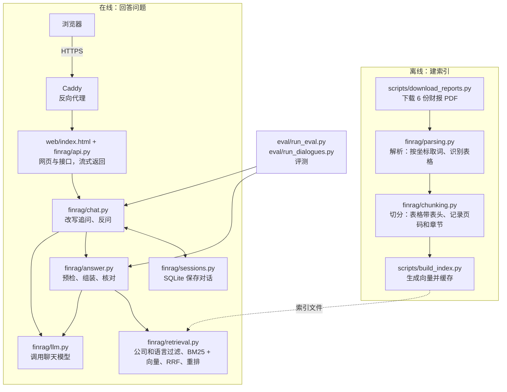

# 财报问答系统（finance-rag）

在线地址：https://finrag.xuxuapi.online

能连续追问的财报对话助手。用中文或英文询问上市公司财报，系统给出带页码引用的答案；证据不足时拒答，不提供投资建议。

**English summary.** A conversational QA assistant over six 2025 annual reports (five companies, Chinese and English), live at https://finrag.xuxuapi.online. It answers follow-up questions ("What about net income?", "And 2024?", "How does it compare with CATL?"), asks for clarification when the company is unclear, and cites PDF pages. Retrieval combines BM25, vector search, RRF fusion and a reranker. It refuses when evidence is insufficient and never gives investment advice. On 100 frozen single-turn questions (80 answerable, 20 refusal), the script marks 88 correct; after Claude re-checked the script's failures against the PDFs and the author confirmed each changed verdict, 92 are correct, 20 of 20 refusals are right, and no fabricated answer was found. On 20 multi-turn dialogues (45 turns), the script marks 38 correct and the same re-check 44. Both sets were used while improving the system, so the scores may be optimistic. Most of the code was written by Claude and Codex; the author made the design decisions, spot-checked the evaluation questions and accepted the results.

## 目录

| 想了解 | 跳到 |
| --- | --- |
| 能做什么 | [能做什么](#能做什么) |
| 怎么设计的 | [架构](#架构)、[关键设计和理由](#关键设计和理由) |
| 效果如何 | [评测](#评测) |
| 有什么局限 | [局限和下一步](#局限和下一步) |
| 怎么部署 | [部署（Docker）](#部署docker) |
| 是谁做的 | [开发方式](#开发方式) |

## 能做什么

| 能力 | 说明 |
| --- | --- |
| 多轮追问 | 问完“比亚迪 2025 年营业收入是多少”，可以接着问“那净利润呢？”“2024 年呢？”“和宁德时代比呢？” |
| 问题不清楚时反问 | 问题需要知道公司，而对话里没有时，列出可查询的公司让用户选 |
| 对话保存 | 刷新页面后对话还在，7 天没有活动后删除；网页有“新对话”按钮 |
| 一题问两家公司 | 分别检索两家，各自回答并标注来源 |
| 指定文档语言 | 问题写明“英文年报”或“中文年报”时，只查对应语言的年报 |
| 先答一部分 | 一题问几项独立信息、只找到其中一部分时，先回答找到的，其余写“该项证据不足” |
| 中英文提问 | 中文问英文财报也能检索 |
| 带引用回答 | 每个事实标来源编号，网页里点引用跳到 PDF 对应页 |
| 证据不足拒答 | 资料里找不到时，回复“证据不足” |
| 不给投资建议 | 调用模型之前用规则拦截，模型提示词里也有同样的规定 |

**资料范围：** 6 份 2025 年报，5 家公司，来源见 `data/manifest.json`。

| 公司 | 文档 | 语言 |
| --- | --- | --- |
| 贵州茅台 | 2025 年年度报告 | 中文 |
| 贵州茅台 | 2025 Annual Report | 英文 |
| 比亚迪 | 2025 年年度报告 | 中文 |
| 招商银行 | 2025 年度报告 | 中文 |
| 宁德时代 | 2025 年年度报告 | 中文 |
| Tesla | 2025 Form 10-K | 英文 |

## 架构



| 层 | 文件 | 一句话职责 |
| --- | --- | --- |
| 数据 | `scripts/download_reports.py`、`data/manifest.json` | 记录并下载财报，校验下载到的是 PDF |
| 解析 | `finrag/parsing.py`、`finrag/text.py` | 把 PDF 变成带页码的段落和表格，统一简繁 |
| 切分 | `finrag/chunking.py` | 切成检索用的片段，表格每段都带表头 |
| 索引 | `scripts/build_index.py` | 生成向量，按内容哈希缓存，避免重复计费 |
| 检索 | `finrag/retrieval.py` | 按公司和文档语言过滤，BM25 和向量各取候选，RRF 合并，重排后取 8 段；点名多家公司时按公司分配名额 |
| 对话 | `finrag/chat.py` | 用最近 3 轮历史把追问改写成完整问题；需要时反问；调用单轮问答 |
| 会话存储 | `finrag/sessions.py` | 用 SQLite 保存每轮的问题、改写、答案、状态和引用；每个会话最多保留 20 轮，7 天没有活动的会话被删除 |
| 问答 | `finrag/answer.py`、`finrag/llm.py` | 预检、组装提示词、流式调用模型、核对引用和数字 |
| 接口和网页 | `finrag/api.py`、`web/index.html` | 流式返回答案，引用可点击跳到 PDF 对应页 |
| 反向代理 | Caddy（部署在宿主机，配置见[部署](#部署docker)） | HTTPS 证书，转发到容器的 8000 端口 |
| 评测 | `eval/` | 冻结的单轮题和多轮对话题、校验脚本、评测脚本和报告 |

模型服务用阿里云百炼：`qwen3.8-flash` 聊天（回答和改写共用）、`text-embedding-v4` 向量、`qwen3-rerank` 重排（走 OpenAI 兼容接口）。

## 关键设计和理由

| 设计 | 做了什么 | 为什么 |
| --- | --- | --- |
| 表格解析 | 不用 PyMuPDF 的 `table.extract()`，按单元格坐标取词（`parsing.py` 的 `_table_rows`）；没有横线的表格，检测到一个单元格里有两行以上数字时，改为按坐标逐行还原 | `table.extract()` 把 `168,838,102,514.79` 拆成了 `168 838 102 514 79 , , , .`；招商银行的表格没有横线，多行数字被合进一个单元格 |
| 切分规则 | 正文每段最多 900 字、相邻重叠 120 字，尽量停在句末；表格按行切，每段最多 1400 字且都重复表头，并带上表格上方 2 行说明；跨页表格沿用上一页表头；文字不跨页合并 | 财报关键数字在表格里，硬切会让数字和表头分家；“单位：元”常写在表格外面；不跨页是为了页码引用准确，代价是换页处的正文会被切断。900 和 120 是经验值，没有做过对比实验 |
| 混合检索 + 重排 | 过滤后，BM25 和向量各取 40 段，用 RRF（k=60）合并，再由重排模型留下 8 段 | 80 道回答题的对比里混合 + 重排最好（见下文）。财报里专有名词和数字多，适合关键词匹配；向量补足换说法和跨语言。重排每次多一次网络请求，延迟和费用没有单独统计 |
| 先改写再检索 | 追问（如“那净利润呢？”）先由模型结合最近 3 轮历史改写成完整问题，再检索和回答；第一句话已写明公司时不调用改写；改写失败、结果无法解析或为空时回退成原句 | 追问本身不含公司、年份和指标，直接检索搜不到内容。第一句写明公司时无需补全，省一次模型调用。回退原句保证改写出错也不会让整轮失败 |
| 历史只用来理解问题 | 历史只交给改写模型，不交给生成答案的模型；回答只依据改写后的问题和检索到的资料 | 避免上一轮的错误被当成事实延续。代价：答不好针对上一轮回答本身的问题（如“你刚才说的那个数字是哪一页？”） |
| 投资建议检查两次 | 改写前对原句检查一次，改写后对完整问题再检查一次；命中就拒答，不调用回答模型；提示词里也要求涉及买卖、持仓的问题整题回复“证据不足” | “那现在值得买吗？”单看这一句不知道是哪家公司，改写后才看得出。规则不能只匹配“买入”，否则会误伤招商银行的科目“买入返售金融资产”（有测试覆盖） |
| 多公司和语言过滤 | 问题点名两家以上公司时，每家单独检索，名额平分（余数给前几家），再交替合并；问题写明“英文年报”或“中文年报”时，只查对应语言的文档；“用英文回答”只算回答语言，不筛选 | 不分名额时，一家公司的片段可能占满 8 个位置；问中文年报却返回英文片段会混淆口径。两种说法同时出现时无法判断，不筛选 |
| 部分回答的边界 | 只有问题明确要求几项独立信息时才允许部分回答：找到的照常回答并标来源，找不到的写“该项证据不足”；涉及买卖、持仓的问题整题拒答，不先列出其他资料 | 一题问两家公司时，只找到一家就整题拒答太保守；但放开后投资类问题曾被部分回答，所以在提示词里单独收紧（见[开发中的典型问题](#开发中的典型问题)） |
| 引用和数字核对 | 提示词要求每个事实标来源编号；没有有效引用的回答改判为拒答；答案里的数字在引用片段中找不到时返回警告（`answer.py` 的 `review`、`find_unverified_numbers`） | 把模型输出当作不可信输入，在模型外面加可以确定的检查。这一步只能确认数字出现在引用里，**查不出读错了列** |
| 向量缓存 | 向量按片段内容哈希缓存，缓存键含模型名和维度 | 相同内容只计费一次；换模型后旧缓存不会被误用 |

## 评测

两套冻结的题目文件，都由不参与实现的 Agent（Codex）出题，作者抽查后冻结。题目文件的 SHA-256 存在对应的 `.sha256` 文件里，内容一改，评测脚本就拒绝运行。下文的“复核”指：脚本判错的题，由 Claude 对照 PDF 原文逐题判断；其中改判为正确的 10 处（单轮 4 题、多轮 6 轮），作者再对照原文逐条确认。

### 单轮：100 道题

| 题目文件 | 题数 | 说明 |
| --- | --- | --- |
| `eval/questions.jsonl` | 30（24 道回答题 + 6 道拒答题） | 第一批，措辞贴近原文，题目写明单位和口径 |
| `eval/questions_v2.jsonl` | 70（56 道回答题 + 14 道拒答题） | 第二批，专门更难：不写单位、不照抄原文、区分口径、跨语言、多公司 |

拒答题共 20 道（公司不在资料内、年份不在资料内、年报未披露、投资建议）。评分口径：同一数字常出现在多页而题目只标了其中一页，所以引用的片段含答案时也算引用正确，这个口径偏松。

**检索对比（80 道回答题，两个题目文件合计，k=8）：**

| 方式 | 题数 | Hit@1 | Hit@3 | Hit@8 | MRR | 找齐全部页面 | 答案在前 8 条 |
| --- | --- | --- | --- | --- | --- | --- | --- |
| bm25 | 80 | 54% | 74% | 79% | 0.633 | 71% | 74% |
| vector | 80 | 51% | 75% | 81% | 0.633 | 78% | 84% |
| hybrid | 80 | 61% | 74% | 84% | 0.688 | 79% | 86% |
| hybrid+rerank | 80 | 64% | 86% | 95% | 0.761 | 88% | 91% |

Hit@k、MRR 按标准页计算，偏严；“答案在前 8 条”看证据内容，偏松。两者要一起看。

**答案（混合 + 重排，100 题）：**

| 项 | 结果 |
| --- | --- |
| 脚本判定 | 88/100（第一批 30/30，第二批 58/70） |
| 复核后 | 92/100；脚本判错的 12 题里，4 题是评分误判（内容正确，字面没对上） |
| 拒答题 | 20/20 正确拒答 |
| 编造答案 | 未发现。没通过的 12 题逐题看过；通过的 88 题靠关键词匹配和数字核对，这两项查不出读错列 |
| 费用 | 100 题合计约 0.35 元（按标价估算） |

复核后剩余 8 道：3 道该答却拒答，4 道一题问两件事、只答出一半，1 道数字对但没写单位。

### 多轮：20 组对话、45 轮

题目文件 `eval/dialogues.jsonl` 同样冻结，共 41 个回答轮、2 个反问轮、2 个拒答轮。

| 项 | 结果 |
| --- | --- |
| 脚本判定 | 38/45 |
| 复核后 | 44/45；脚本判错的 7 轮里 6 轮是同一事实的不同披露（如 `$94.83 billion` 对 94,827 百万美元，数字都在原文里） |
| 真正答错 | 1 轮：问茅台净利润，答成了子公司的净利润（子公司的表里也有这一列） |
| 连续追问 | 15/15 |
| 改写判定 | 41/41（41 个回答轮）。部分关键词是看过系统真实改写后放宽的，不能当作 100% 准确 |
| 费用 | 约 0.19 元（按标价估算） |

### 局限

- 样本量小：单轮 100 题、多轮 45 轮，1 题约 1 个百分点（单轮）。
- 两批题目都在改进系统的过程中用过，分数可能偏乐观。
- 判定是子串匹配，换了写法的正确答案会被判错，所以脚本判错的题都做了复核；复核由 Claude 完成，作者只确认了改判为正确的 10 处，脚本判对的题没有逐条核对，也没有独立的第三方核对。
- 评测题不等于真实用户的提问分布。

### 怎么运行

评测会调用付费的模型接口（回答、改写、重排），先确认 `.env` 里有 API Key。

```bash
# 单轮：检索对比 + 答案评测，两个题目文件都要冻结
uv run python eval/run_eval.py --modes bm25,vector,hybrid,hybrid+rerank --answers hybrid+rerank --questions eval/questions.jsonl,eval/questions_v2.jsonl

# 多轮
uv run python eval/run_dialogues.py
```

报告分别写入 `eval/report.md` 和 `eval/report-dialogues.md`。

## 开发中的典型问题

| 问题 | 原因和处理 |
| --- | --- |
| 表格数字被拆散 | `table.extract()` 把数字拆成碎片，改为按坐标取词。修复前单元测试全过，因为用的是构造的干净数据，之后加了用真实页面的测试。PDF 里带千分位的数字去重后合计 15,970 个，切分结果里全部能原样找到；这只说明没被拆散，不说明和表头对应正确 |
| 只按标准页评分会冤枉正确结果 | q03 的答案出现在 5 页上，题目只标了 1 页。题目已冻结不能改，于是新增“答案在前 8 条”指标，并写明它偏松的代价 |
| 网页用的不是最好的检索方案 | 网页启动时用默认的混合检索（不加重排），测试替换了检索器所以没发现。改为混合 + 重排并加测试；日志改为记录脱敏后的异常信息 |
| 引用页码和页面印的页码对不上 | 引用用的是 PDF 物理页码，和页面上印的页码不一定相同（招商银行物理第 30 页印的是 29）。代码继续用物理页码，网页写成“PDF 第 N 页” |
| Git 换行转换会让冻结哈希失效 | `core.autocrlf` 会改变题目文件的字节，导致哈希对不上。题目文件本来就是 CRLF，所以把两个冻结文件标为 `-text`，按原样存取 |
| 改进后总分没变 | 加了多公司名额、语言筛选和部分回答后，检索指标变好，但投资类问题被部分回答（先列出资料再说证据不足），所以收紧规则：涉及买卖、持仓的问题整题拒答。只看总分看不出变化，逐题对比才看到“修好 3 道、改坏 3 道” |

## 局限和下一步

| 局限 | 说明 |
| --- | --- |
| 评测样本小且用过 | 单轮 100 题、多轮 45 轮；两批题都在改进过程中用过，分数可能偏乐观（详见[评测](#局限)） |
| 答错主体 | 问茅台净利润时答成了子公司的净利润，因为子公司表里也有这一列；数字核对只查“出现过”，查不出这类错误，也查不出读错了列 |
| 部分回答可能不带单位 | 有些表格没有写单位，按“资料里没写就不提”的规则，答案里不会带单位 |
| 一题问两件事 | 单轮评测里有 4 道只答出一半 |
| 合并单元格 | 有合并单元格的表格，真正为空的单元格会让后面的列左移 |
| 资料外的公司 | 问资料里没有的公司时不做公司过滤，只靠模型拒答 |
| 改写多一次模型调用 | 追问（和第一句没写公司的问题）要多一次调用，增加延迟和费用；第一句点名公司时不调用 |
| 对话存储 | SQLite 只适合单实例；没有登录，会话编号相当于访问凭证，知道编号就能看到对话 |
| 运维 | 没有监控告警，没有 CI/CD；限流计数在进程内存里，重启清零 |
| 没做对比实验 | 没有对比过不同的切分大小、Embedding 模型和向量维度；重排的延迟和 Token 费用没有单独统计 |

## 快速开始

环境：Windows、Python 3.12、[uv](https://docs.astral.sh/uv/)。

安装依赖：

```bash
uv sync
```

把 `.env.example` 复制为 `.env`，填入阿里云百炼的 API Key（以 `sk-` 开头）。生成向量和回答问题都要用到它。

下载财报并建立索引。PDF 和索引文件不在 Git 里，第一次运行要用脚本生成：

```bash
uv run python scripts/download_reports.py
uv run python scripts/build_chunks.py
uv run python scripts/build_index.py
```

最后一条默认只估算费用（6 份财报约 1 元）。确认后加 `--yes` 才会真正调用接口生成向量：

```bash
uv run python scripts/build_index.py --yes
```

启动网页：

```bash
uv run python -m finrag.api
```

打开 http://127.0.0.1:8000 。

运行测试（2026-11-09：233 个 Python 测试和 18 个网页测试全部通过；用到真实 PDF 的 6 个测试在缺文件时会跳过，所以刚克隆时是 227 个通过、6 个跳过）：

```bash
uv run pytest
```

```bash
node --test web/client.test.cjs
```

## 部署（Docker）

服务器上只运行问答服务，不解析 PDF、不生成向量：`data/raw/` 和 `data/index/` 在开发机生成后拷贝过去，以只读卷挂载进容器，不打进镜像。镜像里只有代码、网页和 `data/manifest.json`。

1. **准备 `.env`**：在服务器的项目目录里，把 `.env.example` 复制为 `.env` 并填入 API Key。`.env` 不会进镜像，由 `compose.yaml` 的 `env_file` 在运行时注入。
2. **拷贝数据**：把开发机上的 `data/raw/`（约 45MB）和 `data/index/` 拷到服务器项目目录下的同名位置。运行只需要 `data/index/chunks.jsonl` 和 `data/index/embeddings.npy`，其他文件可以不拷。容器以非 root 用户（uid 10001）运行，这些文件需要对其他用户可读（目录可进入）。
3. **构建并启动**：

   ```bash
   docker compose up -d --build
   ```

4. **查看状态和日志**：

   ```bash
   docker compose ps            # STATUS 显示 healthy 即健康检查通过
   docker compose logs -f finrag
   ```

   启动要加载索引，健康检查在启动后 60 秒内的失败不计数。缺密钥或索引时服务会带着中文提示退出，原因能在日志里看到。

5. **更新**：改了代码后重新执行 `docker compose up -d --build`；只更新数据则替换文件后执行 `docker compose restart`。

对话记录保存在容器内 `/app/data/state/sessions.db`（SQLite，对应命名卷 `finrag-state`），超过 7 天没有活动的会话会被自动删除；删除容器不会清除该卷。

端口只绑定在宿主机的 `127.0.0.1:8000`，外部访问要经过宿主机上的反向代理。服务本身不带 HTTPS 和登录，用 Caddy 时最简单的配置如下，Caddy 会自动申请和续期 HTTPS 证书（需要域名已解析到服务器，且防火墙开放 80、443 端口）：

```text
your-domain.example {
	reverse_proxy 127.0.0.1:8000 {
		flush_interval -1
	}
}
```

`flush_interval -1` 让流式回答立即转发，不在代理里缓冲。

### 访问频率限制

`POST /api/ask` 每次都会调用付费的大模型接口，所以做了限流，超限返回 HTTP 429 和中文提示（`/health`、`/api/pdf` 不受限）。可在 `.env` 里调整，修改后执行 `docker compose up -d` 重建容器使其生效：

| 环境变量 | 默认值 | 含义 |
| --- | --- | --- |
| `FINRAG_RATE_LIMIT_PER_IP` | 10 | 每个客户端 IP 在时间窗口内最多提问次数 |
| `FINRAG_RATE_LIMIT_WINDOW_SECONDS` | 60 | 上面那个时间窗口的长度（秒） |
| `FINRAG_DAILY_LIMIT` | 300 | 全站每 24 小时最多提问次数 |
| `FINRAG_DB_PATH` | `data/state/sessions.db` | 对话记录的 SQLite 文件路径 |

注意：

- 计数保存在进程内存里，服务重启后清零；多进程或多副本时各自独立计数。
- 客户端 IP 由 uvicorn 判断：只有连接来自 `FORWARDED_ALLOW_IPS` 里的代理地址时，才采信代理加的 `X-Forwarded-For`，否则用 TCP 连接的对端地址。`compose.yaml` 里设为 Docker 网段 `172.16.0.0/12`，配合端口只绑定本机，只有本机的反向代理能落在这个网段里，客户端伪造的请求头不会被采信。不经过代理直接运行时，默认只信任 `127.0.0.1`。
- 其他可配置项：`FINRAG_HOST`（监听地址，默认 `127.0.0.1`，compose 里设为 `0.0.0.0`）、`FINRAG_PORT`（监听端口，默认 8000；改它时需同步修改 `compose.yaml` 里的端口映射和健康检查）。取值不是正整数时服务拒绝启动。

## 目录结构

| 路径 | 内容 |
| --- | --- |
| `finrag/` | 核心代码：解析、切分、检索、问答、多轮对话（`chat.py`）、会话存储（`sessions.py`）、接口 |
| `scripts/` | 下载财报、生成切分结果、生成向量索引 |
| `data/` | `manifest.json` 财报清单；原始 PDF（`raw/`）和索引文件（`index/`）不进 Git，用脚本生成；对话数据库默认在 `data/state/` |
| `eval/` | 单轮：`questions.jsonl`、`questions_v2.jsonl`、`check_gold.py`、`run_eval.py`、`report.md`；多轮：`dialogues.jsonl`、`check_dialogues.py`、`run_dialogues.py`、`report-dialogues.md`；各题目文件的 `.sha256` |
| `web/` | 网页 |
| `tests/` | 单元测试和用真实财报页面的回归测试 |

## 开发方式

本项目在 AI 编程助手的协助下完成：Claude（Anthropic）编写了大部分代码，负责代码审查，并运行评测和复核结果；Codex 编写了评测题和网页。作者负责需求和方案决策、抽查评测题、确认复核改判和验收。编写评测题的 Agent 不参与实现，以减少评测偏差。
